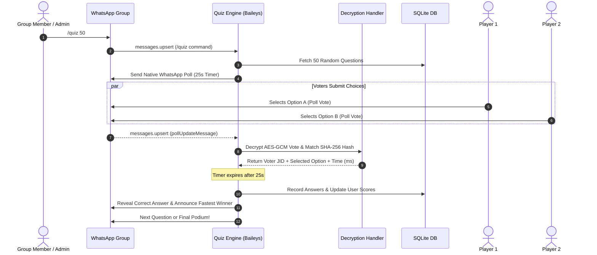

<div align="center">

# 🧠 WhatsApp Group MCQ Quiz Bot
### Interactive Single-Choice Polls • Live Vote Decryption • Real-Time Leaderboard

[](https://nodejs.org/)
[](https://github.com/WhiskeySockets/Baileys)
[](https://nodejs.org/api/sqlite.html)
[](LICENSE)
<br><br>

[](https://render.com/deploy?repo=https://github.com/inyogeshwar/whatsapp-quiz-bot)

An automated, ultra-fast WhatsApp MCQ Quiz Bot designed specifically for WhatsApp Groups. Built with **[@whiskeysockets/baileys](https://github.com/WhiskeySockets/Baileys)** and Node.js native **SQLite**, it sends native single-choice interactive polls, decrypts votes in real time, awards speed bonus points, and maintains group-level and global leaderboards.

[Features](#-key-features) • [Detailed Guide (FEATURES.md)](FEATURES.md) • [Anti-Ban Guide](#%EF%B8%8F-whatsapp-account-safety--anti-ban-guide) • [Installation](#-getting-started) • [Commands](#-commands-cheat-sheet) • [Configuration](#%EF%B8%8F-configuration) • [Architecture](#-architecture--workflow)

</div>

---

## 🌟 Key Features

- **📊 Native Single-Choice Polls:** Sends genuine WhatsApp polls (`selectableCount: 1`). Users tap an option directly—no chat clutter or spam.
- **⚡ Real-Time Vote Decryption:** Decrypts WhatsApp's AES-GCM encrypted poll votes (`pollUpdateMessage`) in milliseconds via SHA-256 option hashing.
- **🏃 Fastest Finger First (Speed Bonus):**
  - 🥇 First correct voter gets **+10 Points**
  - 👏 Subsequent correct voters get **+6 Points**
  - ❌ Wrong voters get **0 Points**
- **🏆 Persistent Leaderboard & Player Tiers:** Tracks rankings with custom tiers (🥉 Rookie, 🥈 Seeker, 🥇 Master, 👑 Grandmaster).
- **📢 WhatsApp Channel Auto-Posting:** Direct integration with WhatsApp Channels (`@newsletter`). Post questions instantly or set auto-pilot timers (`/channel auto 60`).
- **✍️ In-Chat Question Creator:** Add new questions directly from WhatsApp chat with `/addq` without touching files.
- **📢 Group Mention Engine:** Mention all members with `/tagall` or notify everyone when starting a quiz with `/quiz 10 @all`.
- **👤 Player Profile & Accuracy:** Detailed player stats including group rank, win rate %, and total questions answered via `/rank`.
- **📚 Smart Question Engine:**
  - Pre-loaded with **200 Unit 1 - Concept of Bharatvarsha (History)** Hindi MCQs.
  - Supports custom batch sizes (`/quiz 10`, `/quiz 50`, `/quiz all`).
  - Supports category/chapter selection.
  - Auto-normalizes JSON schemas (`answerIndex` or `correctAnswer`).
- **📱 Dual Authentication Modes:**
  - **QR Code Scan:** Directly scan in the terminal.
  - **8-Digit Pairing Code:** Connect by entering an 8-character code in WhatsApp without scanning a screen.
- **🤖 OpenAI-Compatible AI Chatbot:** Connect any AI provider (OpenAI, OpenRouter, Groq, DeepSeek) to answer questions with `/ai <prompt>`. Zero-key free engine included!
- **🎨 Free AI Image Generation:** Generate high-resolution AI art on the fly with `/image <prompt>`.
- **⚡ AI Live Quiz Generator:** Generate fresh MCQs on any custom topic on the fly with `/aiquiz <topic> [count]`.
- **🛡️ Group Auto-Moderation:** Automatically detects slurs and abusive language in Hindi/English, warns users (3 warnings limit), with `/automod`, `/warn`, `/resetwarn`, and `/warnings`.
- **⚡ Reactions & Animated GIFs:** Send emoji reactions (`/react`), celebration animated GIFs (`/gif`), and benchmark latency (`/ping`).
- **🛑 Safe Interrupts:** Stop active quizzes anytime with `/stop` without losing recorded points.

> 📖 **Want to learn how each feature works behind the scenes? Read the comprehensive [FEATURES.md](FEATURES.md) guide.**

---

## 🏗️ Architecture & Workflow



---

## 🚀 Getting Started

### Prerequisites
- **Node.js**: v20+ (Node v22 or v26 recommended with built-in `node:sqlite`).
- **Git**

### 1. Clone the Repository
```bash
git clone https://github.com/inyogeshwar/whatsapp-quiz-bot.git
cd whatsapp-quiz-bot
```

### 2. Install Dependencies
```bash
npm install
```

### 3. Connect to WhatsApp (3 Flexible Methods)

#### Option A: Web Pairing Dashboard (Browser UI ⭐ Recommended)
```bash
npm start
```
1. Open your browser: **`http://localhost:3000`** (or your deployed Render URL).
2. Enter your WhatsApp phone number with country code (e.g., `919876543210`).
3. Click **"Get Pairing Code"** and copy the 8-character code with 1 click!
4. Open WhatsApp > **Linked Devices** > **Link with phone number instead**, and paste the code!

#### Option B: Terminal QR Code
Scan the QR code displayed in the terminal using WhatsApp > **Linked Devices** > **Link a Device**.

#### Option C: CLI Pairing Code
```bash
node index.js --pairing=919876543210
```

---

## ☁️ 1-Click Render Cloud Deployment & 24/7 Anti-Sleep

Aapko apna laptop ya PC chalu rakhne ki zaroorat nahi hai. Bot ko **Render.com** par 24/7 free host kar sakte hain:

### Step 1: 1-Click Deploy on Render
Click the button below to deploy the bot on Render:

[](https://render.com/deploy?repo=https://github.com/inyogeshwar/whatsapp-quiz-bot)

1. Render par login karein aur **"Apply"** par click karein.
2. Render build complete hone ke baad aapko ek live URL dega (e.g., `https://whatsapp-quiz-bot.onrender.com`).
3. Us link ko kholein, apna WhatsApp number dalein aur 8-digit code lein!

### Step 2: Prevent Render From Sleeping (Cron-Job 24/7 Active)
Render ka free tier 15 minute ke baad sleep par chala jata hai. Isko 24/7 hamesha active rakhne ke liye:

1. **Auto Anti-Sleep (Built-in):** Render par Environment Variable me `APP_URL` add karein with your Render URL (e.g. `https://whatsapp-quiz-bot.onrender.com`). Bot khud har 10 minute me apne aapko ping karta rahega!
2. **External Free Cron-Job (100% Guaranteed):**
   - [cron-job.org](https://cron-job.org/) par free account banayein.
   - **Create Cronjob** par click karein.
   - **URL:** `https://your-bot.onrender.com/health` (apna Render URL dalein).
   - **Execution Schedule:** Har 10 minute (`Every 10 minutes`).
   - Save karein! Ab aapka bot **kabhi sleep nahi hoga aur 24/7 active rahega!**

---

## 🎮 Commands Cheat Sheet

Commands can be triggered in groups using **`/`**, **`!`**, or **`.`** (e.g. `/quiz`, `.quiz`, `!quiz`):

| Command | Description | Example |
|---|---|---|
| `/quiz` or `.quiz` | Starts a default 5-question round | `.quiz` |
| `/quiz [count]` | Starts a round with specific number of questions | `.quiz 50` |
| `/quiz all` | Starts a marathon quiz with all questions (200+) | `.quiz all` |
| `/quiz [count] @all` | Starts quiz and mentions all group members | `.quiz 10 @all` |
| `/stop` / `/stopquiz` | Stops the running quiz immediately | `.stop` |
| `/top` / `/leaderboard`| Displays the group's Top 10 rankings with tiers | `.leaderboard` |
| `/rank` / `/score` | Shows individual stats, badge, rank & accuracy % | `.rank` |
| `/tagall [msg]` | Mentions all group members without restriction | `.tagall Quiz time!` |
| `/channel set [link]` | Links your WhatsApp Channel to the bot | `.channel set https://...` |
| `/channel post` | Posts an MCQ poll to the channel right now | `.channel post` |
| `/channel auto [min]` | Schedules automated channel posting | `.channel auto 60` |
| `/channel stop` | Stops channel auto-posting | `.channel stop` |
| `/channel grouplink [link]`| Sets group invite link for channel cross-promotion | `.channel grouplink https://...` |
| `/addq` | Adds a new MCQ directly from chat | `.addq Q? \| O1, O2, O3, O4 \| 1 \| GK` |
| `/ai [prompt]` | Ask AI any question (ChatGPT/Claude/Groq/Free) | `.ai What is quantum computing?` |
| `/aiquiz [topic] [n]`| Generate live fresh MCQs on any topic | `.aiquiz Cricket 5` |
| `/image [prompt]` | Generate free AI images from text prompt | `.image cute dog 4k` |
| `/aisettings` | Configure AI Key, Base URL, Model & Persona | `.aisettings` |
| `/welcome [on/off]` | Welcome card image & mention on new member join | `.welcome on` |
| `/goodbye [on/off]` | Farewell notification on member left/removed | `.goodbye on` |
| `/logout` / `/unlink` | Disconnect WhatsApp bot session (Owner/Admin) | `.logout` |
| `/ping` / `/speed` | Benchmark bot latency, uptime & memory | `.ping` |
| `/react [emoji]` | React to message with emoji | `.react 🔥` |
| `/gif [caption]` | Send high-energy animated celebration GIF | `.gif Great job! 🎉` |
| `/automod [on/off]` | Toggle auto-warning on abusive slurs | `.automod on` |
| `/warn @user [reason]`| Issue warning to group member | `.warn @user breaking rules` |
| `/resetwarn @user` | Clear member warnings | `.resetwarn @user` |
| `/warnings` | Check active warning status | `.warnings` |
| `/categories` | Shows all available question topics in database | `.categories` |
| `/help` | Displays the help menu with all commands | `.help` |

---

## ⚙️ Configuration

Customize the bot settings in `src/config.js`:

```javascript
export const CONFIG = {
  // Primary prefix
  PREFIX: '/',
  
  // Both '/' and '!' are supported
  SUPPORTED_PREFIXES: ['/', '!'],
  
  // Time allotted per question (in seconds)
  QUESTION_TIME_SECONDS: 25,
  
  // Pause between questions (in seconds)
  DELAY_BETWEEN_QUESTIONS: 5,
  
  // Default count per quiz
  DEFAULT_QUESTION_COUNT: 5,
  
  // Maximum allowed questions per round
  MAX_QUESTION_COUNT: 200,
  
  // Points Scheme
  POINTS: {
    FASTEST_CORRECT: 10,  // Winner speed bonus
    CORRECT: 6,           // Other correct voters
    WRONG: 0              // Penalty or 0
  }
};
```

---

## 📝 Adding Custom Questions

You can add or replace questions in `data/questions.json` using this format:

```json
[
  {
    "id": 1,
    "category": "Science",
    "question": "What is the chemical symbol for Gold?",
    "options": ["Ag", "Fe", "Au", "Pb"],
    "answerIndex": 2,
    "correctAnswer": "Au",
    "explanation": "Au comes from the Latin word 'Aurum'."
  }
]
```

*Note: The engine also accepts raw chapter batches with `{ chapter: "...", questions: [...] }` automatically!*

---

## 🛡️ Anti-Cheat & Reliability

- **Single Vote Enforcement:** Only a voter's first submitted vote is timestamped and recorded. Changing poll votes later is ignored.
- **In-Memory Store Synchronization:** Poll secrets are cached in memory so that WhatsApp's encrypted vote receipts are decrypted with 100% accuracy.
- **Fail-Safe Disconnect Recovery:** Automatically reconnects on network timeouts (`DisconnectReason.restartRequired` / `timedOut`).

---

## 🛡️ WhatsApp Account Safety & Anti-Ban Guide (सुरक्षा एवं एंटी-बैन गाइड)

> [!IMPORTANT]
> WhatsApp (Meta) accounts spamming ya unnatural automated activity detect hone par temporary flag ya ban ho sakte hain. Lekin agar aap sahi practices follow karein, toh **ban hone ka risk almost 0%** ho jata hai.

### ⚠️ WhatsApp Number Ban Kyu Hota Hai? (Common Reasons)
1. **Anjaan Numbers ko Direct Message (DM) Bhejna:** Agar bot bina permission ke anjaan logon ko personal messages bhejta hai aur log use "Report as Spam" karte hain.
2. **Users dwara "Report & Block" Kiya Jana:** Meta ke automated spam detection models user reports par actively trigger hote hain.
3. **High-Speed Message Flooding (Spamming):** Ek second me 20–50 messages bina kisi natural delay ke lagataar bhejna.
4. **Fresh / Nayi SIM par Seedhe Bot Chalana:** Naye phone number par pehle hi din hazaron messages flow hone se algorithm turant flag kar deta hai (Account Age issue).
5. **Unauthorized Bulk Broadcasts:** Mass marketing lists par unsolicited messages bhejna.

### 🛡️ Hamara Quiz Bot Kyu Safe Hai?
Hamare is Quiz Bot ka architecture safe aur compliant banaya gaya hai:
- ✅ **No Personal DMs:** Bot kisi ke private inbox me jakar unprompted message nahi bhejta.
- ✅ **Only In-Group Replies:** Ye sirf group me commands (`/quiz`, `/ai`, `/image`) ya poll responses par react karta hai.
- ✅ **Built-in Delays:** Har question ke beech 25 second ka answer timer aur 5 second ka pause rehta hai, jisse WhatsApp algorithm ko spamming ka signal nahi milta.
- ✅ **Native Polls:** WhatsApp ke official Single-Choice Polls ka use karta hai bina chat ko spam kiye.

### 🔒 Ban Se Bachne Ke Golden Rules (Anti-Ban Best Practices)
1. **Personal / Main Number Use Na Karein:** Hamesha ek **Secondary / Alternate SIM** ya dedicated bot number use karein taaki aapka personal family/friends ka account disturb na ho.
2. **Number ko thoda Warm-Up Karein:** Naye number ko pehle 2–3 din normal use karein (1-2 dosto se regular chat karein), uske baad hi bot par lagayein.
3. **Sirf Apne Groups Me Add Karein:** Bot ko anjaan logo ke random groups me mat daalein jahan koi bina wajah report kar sake.
4. **Auto-Broadcasting Se Bachein:** Unsolicited spam broadcasting scripts na chalayein.

### 💡 Agar Kabhi Account Flag/Ban Ho Jaye Toh Kya Karein? (Unban in 12-24h)
Agar WhatsApp par *"This account is not allowed to use WhatsApp"* screen aati hai, toh ghabraiye mat:
1. WhatsApp app me **"Request a Review"** button par tap karein.
2. Reason box me ye appeal message likhein:
   > *"Hello WhatsApp Support, my number was flagged by mistake. I use this number only for educational group quiz discussions and general knowledge practice with students. Please review and restore my account."*
3. **12 se 24 ghante** ke andar Meta support team account review karke access restore kar deti hai.

---

## 📄 License

This project is licensed under the [MIT License](LICENSE).

---

<div align="center">
Made with ❤️ for educational WhatsApp communities.
</div>
