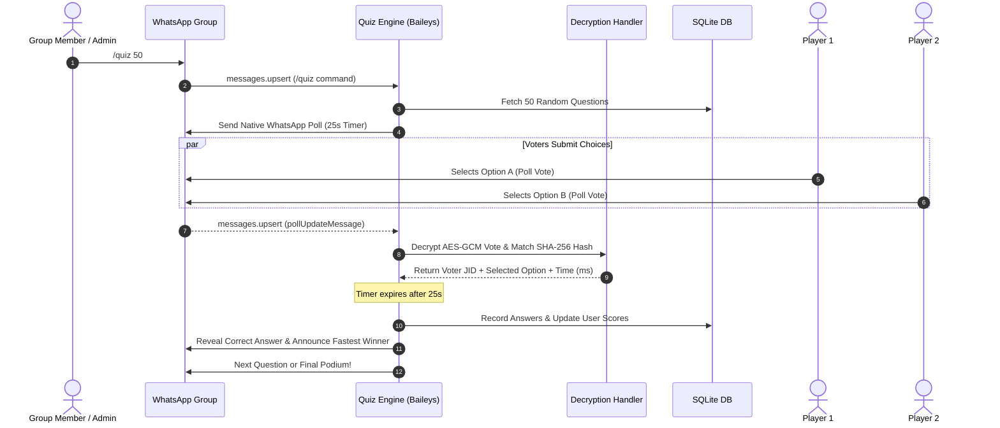

<div align="center">

# 🧠 WhatsApp Group MCQ Quiz Bot
### Interactive Single-Choice Polls • Live Vote Decryption • Real-Time Leaderboard

[](https://nodejs.org/)
[](https://github.com/WhiskeySockets/Baileys)
[](https://nodejs.org/api/sqlite.html)
[](LICENSE)

An automated, ultra-fast WhatsApp MCQ Quiz Bot designed specifically for WhatsApp Groups. Built with **[@whiskeysockets/baileys](https://github.com/WhiskeySockets/Baileys)** and Node.js native **SQLite**, it sends native single-choice interactive polls, decrypts votes in real time, awards speed bonus points, and maintains group-level and global leaderboards.

[Features](#-key-features) • [Installation](#-getting-started) • [Commands](#-commands-cheat-sheet) • [Configuration](#%EF%B8%8F-configuration) • [Architecture](#-architecture--workflow)

</div>

---

## 🌟 Key Features

- **📊 Native Single-Choice Polls:** Sends genuine WhatsApp polls (`selectableCount: 1`). Users tap an option directly—no chat clutter or spam.
- **⚡ Real-Time Vote Decryption:** Decrypts WhatsApp's AES-GCM encrypted poll votes (`pollUpdateMessage`) in milliseconds via SHA-256 option hashing.
- **🏃 Fastest Finger First (Speed Bonus):**
  - 🥇 First correct voter gets **+10 Points**
  - 👏 Subsequent correct voters get **+6 Points**
  - ❌ Wrong voters get **0 Points**
- **🏆 Persistent Leaderboard (SQLite):** Tracks top rankers, medals (🥇, 🥈, 🥉), correct answer counts, and fastest response streaks.
- **👤 Player Profile & Accuracy:** Detailed player stats including group rank, win rate %, and total questions answered via `/rank`.
- **📚 Smart Question Engine:**
  - Pre-loaded with **200 Unit 1 - Concept of Bharatvarsha (History)** Hindi MCQs.
  - Supports custom batch sizes (`/quiz 10`, `/quiz 50`, `/quiz all`).
  - Supports category/chapter selection.
  - Auto-normalizes JSON schemas (`answerIndex` or `correctAnswer`).
- **📱 Dual Authentication Modes:**
  - **QR Code Scan:** Directly scan in the terminal.
  - **8-Digit Pairing Code:** Connect by entering an 8-character code in WhatsApp without scanning a screen.
- **🛑 Safe Interrupts:** Stop active quizzes anytime with `/stop` without losing recorded points.

---

## 🏗️ Architecture & Workflow



---

## 🚀 Getting Started

### Prerequisites
- **Node.js**: v20+ (Node v22 or v26 recommended with built-in `node:sqlite`).
- **Git**

### 1. Clone the Repository
```bash
git clone https://github.com/inyogeshwar/whatsapp-quiz-bot.git
cd whatsapp-quiz-bot
```

### 2. Install Dependencies
```bash
npm install
```

### 3. Connect to WhatsApp

#### Option A: QR Code (Standard)
```bash
npm start
```
1. Open **WhatsApp** on your phone.
2. Go to **Settings / Three Dots (⋮) > Linked Devices > Link a Device**.
3. Scan the QR code generated in your terminal.

#### Option B: Pairing Code (No Camera Needed)
```bash
node index.js --pairing=919876543210
```
*(Replace `919876543210` with your phone number with country code, without `+`)*
1. Go to **WhatsApp > Linked Devices > Link a Device**.
2. Tap **"Link with phone number instead"**.
3. Enter the 8-digit code shown in your terminal.

---

## 🎮 Commands Cheat Sheet

Commands can be triggered in groups using **`/`** (or `!`):

| Command | Description | Example |
|---|---|---|
| `/quiz` | Starts a default 5-question round | `/quiz` |
| `/quiz [count]` | Starts a round with specific number of questions | `/quiz 50` |
| `/quiz all` | Starts a marathon quiz with all questions (200+) | `/quiz all` |
| `/quiz [count] [topic]`| Runs questions from a specific category | `/quiz 10 history` |
| `/stop` / `/stopquiz` | Stops the running quiz immediately | `/stop` |
| `/top` / `/leaderboard`| Displays the group's Top 10 rankings | `/leaderboard` |
| `/rank` / `/score` | Shows your individual stats, rank & accuracy % | `/rank` |
| `/categories` | Shows all available question topics in database | `/categories` |
| `/help` | Displays the help menu with all commands | `/help` |

---

## ⚙️ Configuration

Customize the bot settings in `src/config.js`:

```javascript
export const CONFIG = {
  // Primary prefix
  PREFIX: '/',
  
  // Both '/' and '!' are supported
  SUPPORTED_PREFIXES: ['/', '!'],
  
  // Time allotted per question (in seconds)
  QUESTION_TIME_SECONDS: 25,
  
  // Pause between questions (in seconds)
  DELAY_BETWEEN_QUESTIONS: 5,
  
  // Default count per quiz
  DEFAULT_QUESTION_COUNT: 5,
  
  // Maximum allowed questions per round
  MAX_QUESTION_COUNT: 200,
  
  // Points Scheme
  POINTS: {
    FASTEST_CORRECT: 10,  // Winner speed bonus
    CORRECT: 6,           // Other correct voters
    WRONG: 0              // Penalty or 0
  }
};
```

---

## 📝 Adding Custom Questions

You can add or replace questions in `data/questions.json` using this format:

```json
[
  {
    "id": 1,
    "category": "Science",
    "question": "What is the chemical symbol for Gold?",
    "options": ["Ag", "Fe", "Au", "Pb"],
    "answerIndex": 2,
    "correctAnswer": "Au",
    "explanation": "Au comes from the Latin word 'Aurum'."
  }
]
```

*Note: The engine also accepts raw chapter batches with `{ chapter: "...", questions: [...] }` automatically!*

---

## 🛡️ Anti-Cheat & Reliability

- **Single Vote Enforcement:** Only a voter's first submitted vote is timestamped and recorded. Changing poll votes later is ignored.
- **In-Memory Store Synchronization:** Poll secrets are cached in memory so that WhatsApp's encrypted vote receipts are decrypted with 100% accuracy.
- **Fail-Safe Disconnect Recovery:** Automatically reconnects on network timeouts (`DisconnectReason.restartRequired` / `timedOut`).

---

## 📄 License

This project is licensed under the [MIT License](LICENSE).

---

<div align="center">
Made with ❤️ for educational WhatsApp communities.
</div>
